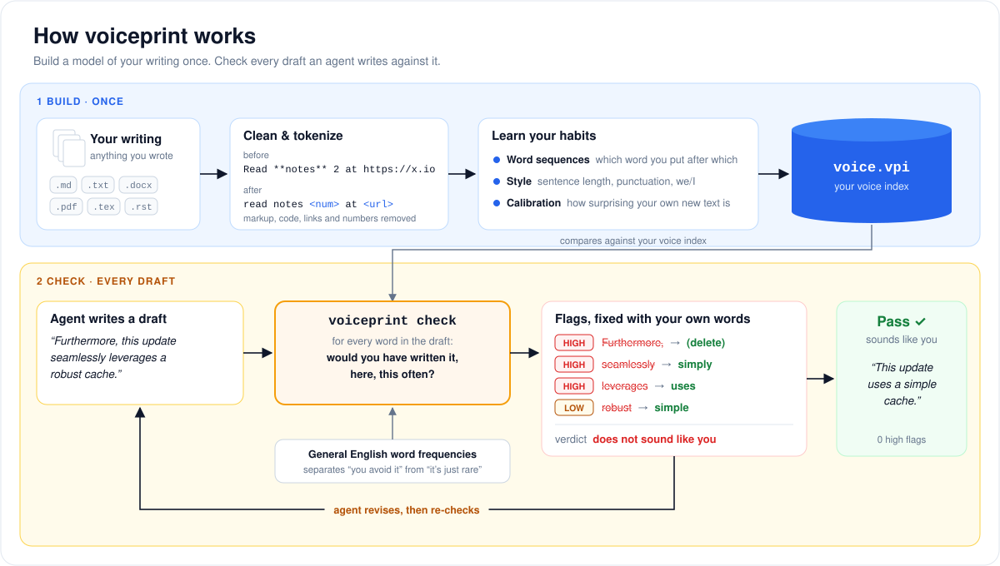

# voiceprint

Let agents write like you.

Telling an LLM to "write like me" is only a suggestion. voiceprint turns it into a
measurement. It builds a small statistical language model from text you wrote. It
learns which word you put after which, and how often you use each word compared
with general English. Then it checks a draft an agent wrote, flags the words you
would not have used, and offers replacements you *have* used, ranked in context.

You choose the text it learns from: posts, docs, emails, notes, anything you wrote.
What goes in is up to you, and the model only knows what you give it.

## How it works



1. **Build** reads your files, cleans them, and fits a word-level n-gram model
   (interpolated Kneser-Ney, default order 4). It cross-validates over your
   documents, so "surprising" means surprising *compared with your own writing
   that the model hasn't seen*, not compared with an absolute number.
   [How it learns](#how-it-learns-your-voiceprint) walks through this step by step.
2. **Check** scores each word of a draft against that model and against general
   English frequencies. It separates "you avoid this word" (flag it) from "this
   is just a rare technical word" (leave it alone).
3. **Suggestions** come from a curated plain-language map plus WordNet synonyms.
   They're filtered to words *you* have actually used and ranked by how well
   they fit the surrounding words under your model.
4. **The loop:** an agent drafts, runs `check`, revises what's flagged, and checks
   again until the draft passes. The bundled skill does this for you.

### How it learns your voiceprint


1. **Read and clean.** Markup, code, links and numbers are stripped or replaced
   with placeholders, so only your wording is left.
2. **Split and pad.** Each sentence gets start markers (`<s>`) and an end marker
   (`</s>`), so the model also learns how you open and close sentences.
3. **Slide a window.** Every 3-word context is paired with the word you wrote next.
4. **Count.** For each context, it counts which words followed and how often.
   It also keeps a slot index (left word, right word → middle words), which
   suggestions come from.
5. **Blend.** Kneser-Ney smoothing mixes your counts for the full context with
   shorter contexts, so contexts you've never written still get a sensible,
   non-zero score.
6. **Compare with English.** Your rate for each word against its general-English
   rate shows the words you favour and the common ones you avoid.
7. **Style.** Sentence length, punctuation and pronoun habits are measured per
   ~300-word chunk, giving your typical range for each.
8. **Calibrate.** Each document is scored by a model trained on the others. This
   shows how surprising your *own* new writing is, and that becomes the bar for
   "unusual".

The diagrams are generated by `docs/diagrams.py`.

### What gets flagged

| Flag | Meaning |
|---|---|
| **marker / phrase** | A word or construction LLMs over-use (`data/llm_markers.txt`) that *you* rarely use. If you genuinely write "robust" a lot, it's left alone. |
| **underused** | A common English word you use at under 1/5 of its general rate, where your corpus is big enough for that to be significant (Poisson test). |
| **context** | A common word in your most surprising 5% of positions, where a synonym fits much better under your model. |
| **style** | Sentence length, commas, em dashes, semicolons, parentheses, we/I, contractions or transition words outside your usual range. |

## Install

voiceprint is a single native binary (macOS, Linux and Windows; x64 and arm64), shipped via npm:

```bash
npm install -g voiceprint
```

Or run it without installing, using `npx voiceprint ...`. To build from source instead,
use `cargo install --git https://github.com/Minitour/voiceprint`.

Everything it needs is bundled: general-English word frequencies (wordfreq) and a
synonym table (WordNet plus a curated plain-language map). It makes no network calls.

## Use

Build your index once, from any files or folders of your writing:

```bash
voiceprint build ~/writing -o ~/.voiceprint/voice.vpi
```

Check a draft:

```bash
voiceprint check draft.md
```

Other commands:

```
voiceprint check draft.md --json            # for agents
voiceprint check draft.md --annotate        # inline [[word -> alt | alt]]
voiceprint check draft.md --fail-on high    # exit 1 for hooks / CI
voiceprint profile -o voice-card.md         # your style norms, signature words, words you never use
voiceprint kwic "in particular"             # how you actually use a phrase
voiceprint suggest --left "results are" --word crucial --right "for deployment"
voiceprint complete "as a result we"        # autocomplete from your writing
```

Set `VOICEPRINT_INDEX` to skip `-i`.

### Choosing what it learns from

- **Only include text you wrote.** Quoted material, templates, and generated text
  teach the model someone else's voice.
- **Use a sources file** to pin exactly which files go in: one path per line (see
  `sources.example.txt`), then run `voiceprint build @sources.txt`. Use
  `--exclude GLOB` to skip drafts, and `--dump-clean DIR` to see what the cleaner kept.
- **Build one index per register.** An index of formal writing will (correctly)
  flag "hi", "thanks" and "you" in a casual email, so build separate ones and
  switch with `-i`.
- **Keep personal sources files in `local/`,** which is gitignored.

## Agent plugin

The `write-like-me` skill has an agent read your voice card, draft to a file, run
`check`, revise flag by flag, and re-check until there are no high-severity flags. It
calls the `voiceprint` CLI, falling back to `npx voiceprint` if it isn't installed.

It ships as a portable plugin in [`plugins/voiceprint/`](plugins/voiceprint/README.md)
(Agent Plugins 1.0), with marketplace files for Claude Code, Cursor and Codex. Install it
through your agent's plugin manager; no clone needed.

<details>
<summary><strong>Claude Code</strong></summary>

```text
/plugin marketplace add Minitour/voiceprint
/plugin install voiceprint@voiceprint
```

The skill appears as `/voiceprint:write-like-me`. Reload with `/reload-plugins` after updates.
</details>

<details>
<summary><strong>Cursor</strong></summary>

In Agent chat:

```text
/add-plugin https://github.com/Minitour/voiceprint
```

Then install **voiceprint** from the imported marketplace. See [Cursor plugins](https://cursor.com/docs/plugins).
</details>

<details>
<summary><strong>Codex</strong></summary>

```bash
codex plugin marketplace add Minitour/voiceprint
```

Then install **voiceprint** from the Plugin Directory. See [Codex plugin packaging](https://developers.openai.com/plugins/build/plugins).
</details>

<details>
<summary><strong>CAPA</strong></summary>

```bash
capa add Minitour/voiceprint@write-like-me --install
```

Append a tag to pin a release, e.g. `Minitour/voiceprint@write-like-me:v0.1.1`.
</details>

Any of these needs an index first: `npx voiceprint build <your writing> -o ~/.voiceprint/voice.vpi`.

## Validation

Git's release notes stood in for an author: 318 notes, 260k words, mostly written by
one maintainer. v2.51 to v2.54 were held out:

| Text | flags /100 words | high | verdict |
|---|---|---|---|
| 6 real held-out release notes | 1.3 to 4.5 | 0 to 1 | close to your voice (all 6) |
| LLM-style rewrite of v2.54 | 12.3 | 15 | does not sound like you |

`python/tests/fixtures/` has the rewrite. Run `cargo test` for the unit tests.

## Repository layout

| Path | What it is |
|---|---|
| `src/` | The Rust CLI (what ships) |
| `data/` | Bundled data: word frequencies, synonyms, LLM-marker list. Licenses in `data/NOTICE.md` |
| `npm/` | The npm launcher and the script that assembles per-platform packages |
| `python/` | The original Python implementation. Unpublished; it regenerates `data/` and serves as the parity reference |
| `plugins/voiceprint/` | The agent plugin: the `write-like-me` skill plus Claude Code, Codex and Cursor manifests |
| `.claude-plugin/`, `.cursor-plugin/`, `.agents/plugins/` | Marketplace files that point each client at `plugins/voiceprint` |
| `docs/` | Diagrams and their generator |

Releases: bump `version` in `Cargo.toml` and the plugin manifests (CI checks they match), then push a `v<version>` tag. The Release
workflow builds all six binaries and publishes `@voiceprint/<platform>` plus `voiceprint`
to npm through trusted publishing (GitHub OIDC), so no npm token is stored anywhere.
Every package lists `release.yml` in this repo as its trusted publisher; `npm/trust.mjs`
sets that up.

## Limits

- **It doesn't detect or remove watermarks.** Some providers embed statistical
  watermarks in generated text. voiceprint measures *style*, meaning words you
  wouldn't use. It doesn't target, detect, or verify watermarks, and its edits
  shouldn't be relied on to remove one.
- **It knows co-occurrence, not meaning.** Suggestions need judgment; the skill
  makes the agent supply it.
- **It needs enough text.** Below ~30k words the model is thin; 100k+ is comfortable.
- **New topics bring new vocabulary.** "underused" flags on technical terms should
  be kept, not "fixed".
- **PDF extraction is lossy.** voiceprint drops table-of-contents lines, splits
  glued words, and repairs dropped fi/fl ligatures, but source formats like
  Markdown or LaTeX are cleaner. Check with `--dump-clean`.
- **The index contains your text.** `voice.vpi` is gzipped JSON that includes your
  cleaned sentences (for `kwic`), so treat it as private as the writing itself.
